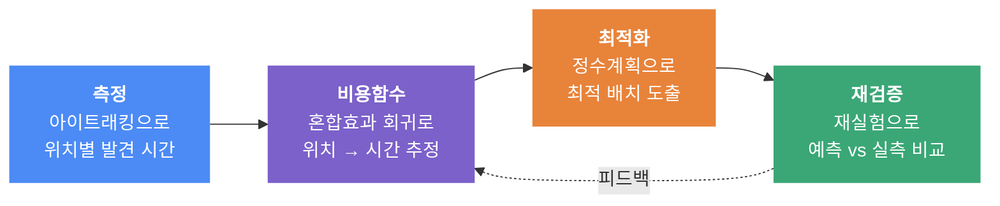

<div align="center">

# E-T-A

### Eye-Tracking-Analysis

**아이트래킹 기반 발견 시간 모델링을 통한 올리브영 앱 화면 배치 최적화**

*"어디에 두면 더 빨리 찾을까"를 감이 아니라 수치로 답하고, 그 수치로 배치를 계산한다*

<br>


`Eye Tracking` · `Mixed Effects Model` · `Integer Programming` · `UX Research`

</div>

---

## 프로젝트 개요

개인화 진단 서비스는 커머스 앱의 핵심 기능이 되었다. 올리브영의 AI 피부진단 서비스 **스킨스캔**은 매장 기준 누적 이용 100만 건을 넘겼고, 회사 발표에 따르면 이용 고객의 구매 전환율은 **73%**로 미이용 고객(53%)보다 20%p 높다.

그런데 2026년 9월 모바일로 확장되면서 상황이 바뀌었다. 매장에서는 직원이 안내하고 기기가 눈에 보였지만, **앱에서는 사용자가 스스로 진입점을 찾아야 한다.** 발견되지 않는 기능은 사용자에게 존재하지 않는 것과 같다.

본 프로젝트는 시선 추적으로 화면 위치별 발견 시간을 측정하고, 이를 비용함수로 추정해 요소 배치를 최적화한 뒤, 재실험으로 검증한다.

<br>

## 핵심 아이디어



기존 UX 연구는 개선안을 **연구자의 판단**으로 만들었다. 본 연구는 개선안을 **최적화 문제의 해**로 산출하고, 모델이 예측한 개선 폭이 실제로 재현되는지까지 검증한다.

<br>

## 연구 질문

| | 질문 | 방법 |
|:---:|---|---|
| **RQ1** | 사용자는 스킨스캔을 얼마나 인지하며, 어떤 기능을 자주 찾는가 | 인식 조사 설문 |
| **RQ2** | 화면 내 위치는 발견 시간(TTFF)에 유의한 영향을 주는가 | 아이트래킹 실험 + 혼합효과 회귀 |
| **RQ3** | 비용함수로 배치를 최적화하면 가중 평균 발견 시간이 감소하는가 | 정수계획 + 기준선 비교 |
| **RQ4** | 예측한 개선 폭이 실제 사용자에게 재현되는가 | 재실험 + 통계 검정 |

<br>

## 방법

### 1. 비용함수 추정

참가자별 편차를 랜덤효과로 흡수하는 혼합효과 모형으로, 위치가 발견 시간에 주는 영향을 추정한다.

$$\text{TTFF}_{pij} = \beta_0 + \beta_1 x_j + \beta_2 y_j + \beta_3 d_j + \beta_4 s_i + \beta_5 c_p + u_p + \varepsilon_{pij}$$

| 기호 | 의미 |
|:---:|---|
| $x_j, y_j$ | 슬롯 $j$의 좌표 |
| $d_j$ | 주변 요소 밀도 |
| $s_i$ | 요소 $i$의 크기 |
| $c_p$ | 참가자 $p$의 사용 경험 (설문) |
| $u_p$ | 참가자 랜덤효과 |

### 2. 배치 최적화

추정된 예측값을 비용으로 하는 할당 문제로 정식화한다.

$$\min \sum_{i}\sum_{j} \left( w_i \hat{t}_{ij} + \lambda d_{ij} \right) x_{ij}$$

$$\text{s.t.} \quad \sum_{j} x_{ij} = 1 \;\; \forall i, \qquad \sum_{i} x_{ij} \le 1 \;\; \forall j, \qquad x_{ij} \in \{0,1\}$$

$w_i$는 설문에서 산정한 사용 빈도 가중치, $\hat{t}_{ij}$는 예측 발견 시간, $d_{ij}$는 현행 위치로부터의 이동 거리, $\lambda$는 학습 비용 가중치다.

> **제약 조건** — 검색창과 하단 탭은 위치 고정, 동일 성격의 카테고리는 인접 배치
>
> **기준선** — 현행 배치 · 무작위 배치 · 사용 빈도순 배치

<br>

## 실험 설계

<table>
<tr><td width="25%"><b>장비</b></td><td>Tobii X2-60 Compact (화면 기반, 60Hz) / Tobii Studio 3.4.8</td></tr>
<tr><td><b>참가자</b></td><td>10~12명, 피험자 내 반복측정</td></tr>
<tr><td><b>자극</b></td><td>올리브영 앱 화면 캡처 4종 — 현행(S0), 무작위 재배치(S1·S2), 빈도순(S3)</td></tr>
<tr><td><b>과제</b></td><td>사용자 여정을 단계로 분해, 단계당 목표 요소 1개, 기능명을 숨긴 상황 문장으로 제시</td></tr>
<tr><td><b>측정</b></td><td>TTFF(주), 과제 완료 시간, 응시 시간, 고정 횟수, 오클릭률, SUS</td></tr>
<tr><td><b>통제</b></td><td>과제·화면 순서 무작위화, 절반 역순 상쇄, 사용 경험을 모형 변수로 투입</td></tr>
</table>

동일 요소가 여러 위치에 나타나도록 변형 화면을 설계해 **위치 효과와 요소 고유 효과를 분리**한다.

<br>

## 가설

| | 가설 | 검정 |
|:---:|---|---|
| **H1** | 요소의 위치에 따라 TTFF가 유의하게 다르다 | 혼합효과 모형의 위치 효과 |
| **H2** | 위치·크기·밀도 모형이 단순 평균 모형보다 정확하다 | 참가자 단위 교차검증 RMSE |
| **H3** | 최적화된 배치가 가중 평균 발견 시간을 단축한다 | 재실험 반복측정 검정 |
| **H4** | 계수 불확실성 하에서도 최적해가 안정적이다 | 신뢰구간 내 반복 추출 |
| **H5** | 인지도가 낮은 기능일수록 발견 시간이 길다 | 설문 인지도 × TTFF 상관 |

<br>

## 기술 스택

| 영역 | 도구 |
|---|---|
| 데이터 수집 | Tobii Studio, Google Forms |
| 전처리·분석 | Python, pandas, NumPy |
| 통계 모델링 | statsmodels (Mixed Linear Model), SciPy |
| 최적화 | PuLP + HiGHS |
| 시각화 | Matplotlib, Seaborn |
| 프로토타입 | Figma / HTML |

<br>

## 폴더 구조

```
TAVE18_ETA_Project/
├── data/
│   ├── raw/              # 원본 (개인정보 포함, git 제외)
│   └── processed/        # 전처리 완료 데이터
├── notebooks/            # 탐색적 분석, 결과 시각화
├── src/
│   ├── preprocess.py     # 시선 로그 → AOI → TTFF
│   ├── model.py          # 비용함수 추정
│   └── optimize.py       # 배치 최적화
├── results/              # 그림, 표
└── docs/                 # 기획안, 회의록, 발표 자료
```

> 참가자 설문 응답과 시선 데이터 원본은 개인정보 보호를 위해 저장소에 포함하지 않습니다.

<br>

## 일정

| 단계 | 회차 | 내용 |
|:---:|:---:|---|
| 기획 | 1–3 | 주제 확정, 설문 배포, 파일럿 실험 |
| 수집 | 4–6 | 설문 분석, 본 실험, 탐색적 분석 |
| 모델링 | 7–9 | 비용함수 추정, 최적화, 강건성 분석 |
| 검증 | 10–12 | 프로토타입 제작, 재실험, 결과 정리 |

**2026.11 ~ 2027.01** · 중간 발표 2026.11.21 · 최종 발표 2027.01.30

<br>

## 팀

<div align="center">

| 역할 | 담당 |
|---|---|
| **총괄 · 모델링** | 김예빈 |
| **데이터 수집 및 전처리** | 가세희 · 김동건 · 임하영 |
| **모델링 & 튜닝** | 김소희 · 윤소영 |
| **시각화 & 리포트** | 김동건 · 박진오 |

</div>

<br>

## 참고 문헌

- 박가율 (2026). *딥러닝 언어 모델과 시선 추적 기반 모바일 금융앱 UX 개선*. 아주대학교.
- Pagano, D. & Maalej, W. (2013). *User feedback in the AppStore: An empirical study*. IEEE RE.
- Pirolli, P. & Card, S. (1999). *Information Foraging*. Psychological Review, 106(4).
- Oulasvirta, A. et al. *Combinatorial Optimization of Graphical User Interface Designs*. Aalto University.
- Feit, A. et al. (2017). *Toward Everyday Gaze Input*. CHI.

<br>

---

<div align="center">

**TAVE 18기 데이터분석 파트 후반기 심화 프로젝트**

<sub>본 프로젝트는 학술 목적의 학생 연구이며, CJ올리브영과 공식적인 관련이 없습니다.<br>
앱 화면은 연구 목적으로만 사용되었습니다.</sub>

</div>
