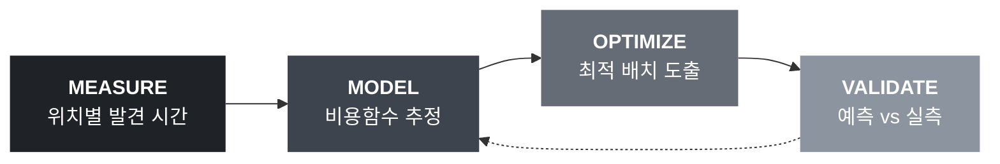

<div align="center">

# E-T-A

**Eye-Tracking-Analysis**

아이트래킹 기반 발견 시간 모델링을 통한 올리브영 앱 화면 배치 최적화

<br>


`Eye Tracking` · `Mixed Effects Model` · `Integer Programming` · `UX Research`

</div>

<br>

## Overview

**문제.** 올리브영 AI 피부진단 서비스 '스킨스캔'은 매장 누적 이용 100만 건, 이용 고객 구매 전환율 73% (미이용 53%, 회사 발표 기준). 2026년 9월 모바일 확장 이후 사용자가 직접 진입점을 탐색해야 하는 구조로 전환.

**공백.** 진입점의 발견 속도는 미측정 영역. 실무의 UI 개선은 디자이너 판단과 A/B 테스트에 의존하며, 위치가 발견 시간에 미치는 영향을 정량화해 배치 결정에 반영한 사례는 희소.

**접근.** 시선 추적으로 위치별 발견 시간을 측정 → 비용함수로 추정 → 정수계획으로 배치 최적화 → 재실험으로 검증.

<br>



<br>

**차별점** — 선행 연구는 개선안을 연구자 판단으로 설계. 본 연구는 개선안을 최적화 문제의 해로 산출하고, 예측 개선율과 실측 개선율의 일치 여부까지 검증.

<br>

## Research Questions

| | Question | Method |
|:--:|---|---|
| **RQ1** | 스킨스캔 인지도 및 기능별 사용 빈도 | 인식 조사 설문 |
| **RQ2** | 화면 내 위치가 발견 시간에 미치는 영향 | 아이트래킹 + 혼합효과 회귀 |
| **RQ3** | 최적화 배치의 가중 평균 발견 시간 단축 효과 | 정수계획 + 기준선 비교 |
| **RQ4** | 예측 개선 폭의 실제 재현 여부 | 재실험 + 통계 검정 |

<br>

## Method

### 1. Cost Function

참가자별 편차를 랜덤효과로 분리한 혼합효과 모형.

```math
\text{TTFF}_{pij} = \beta_0 + \beta_1 x_j + \beta_2 y_j + \beta_3 d_j + \beta_4 s_i + \beta_5 c_p + u_p + \varepsilon_{pij}
```

| Symbol | Definition |
|:--:|---|
| `x_j`, `y_j` | 슬롯 j의 좌표 |
| `d_j` | 주변 요소 밀도 |
| `s_i` | 요소 i의 크기 |
| `c_p` | 참가자 p의 사용 경험 (설문 측정) |
| `u_p` | 참가자 랜덤효과 |

모형 후보 3종 → 참가자 단위 교차검증으로 선택. 계수 신뢰구간은 부트스트랩 추정.

<br>

### 2. Layout Optimization

추정 예측값을 비용으로 하는 할당 문제.

```math
\min \sum_{i}\sum_{j} \bigl( w_i \hat{t}_{ij} + \lambda d_{ij} \bigr) x_{ij}
```

```math
\text{s.t.} \quad \sum_{j} x_{ij} = 1 \;\; \forall i \qquad \sum_{i} x_{ij} \le 1 \;\; \forall j \qquad x_{ij} \in \{0,1\}
```

| Symbol | Definition | Source |
|:--:|---|---|
| `w_i` | 요소 i의 사용 빈도 가중치 | 설문 (주), 앱 리뷰 분류 (보조) |
| `t̂_ij` | 요소 i를 슬롯 j에 배치 시 예측 발견 시간 | 1단계 회귀 모형 |
| `d_ij` | 현행 위치로부터의 이동 거리 | 현행 배치 |
| `λ` | 학습 비용 가중치 | 민감도 분석으로 범위 탐색 |

**제약** — 검색창·하단 탭 위치 고정, 동일 성격 카테고리 인접 배치
**기준선** — 현행 배치 · 무작위 배치 · 사용 빈도순 배치
**구현** — PuLP + HiGHS

<br>

## Experiment

| | |
|---|---|
| **장비** | Tobii X2-60 Compact (화면 기반, 60Hz) / Tobii Studio 3.4.8 |
| **참가자** | 10–12명, 피험자 내 반복측정 |
| **자극** | 앱 화면 캡처 4종 — 현행 S0, 무작위 재배치 S1·S2, 빈도순 S3 |
| **과제** | 사용자 여정 단위 분해, 단계당 목표 요소 1개, 기능명 비노출 상황 문장 |
| **측정** | TTFF (주), 과제 완료 시간, 응시 시간, 고정 횟수, 오클릭률, SUS |
| **통제** | 과제·화면 순서 무작위화, 절반 역순 상쇄, 사용 경험 변수 투입 |

동일 요소를 복수 위치에 배치 → 위치 효과와 요소 고유 효과 분리.

<br>

## Hypotheses

| | Hypothesis | Test |
|:--:|---|---|
| **H1** | 위치에 따른 TTFF 차이 존재 | 혼합효과 모형 위치 효과 |
| **H2** | 위치·크기·밀도 모형 > 단순 평균 모형 | 교차검증 RMSE |
| **H3** | 최적화 배치의 발견 시간 단축 | 반복측정 검정 |
| **H4** | 계수 불확실성 하 최적해 안정성 | 신뢰구간 내 반복 추출 |
| **H5** | 인지도와 발견 시간의 음의 관계 | 설문 인지도 × TTFF 상관 |

표본 규모를 고려해 p값과 함께 효과 크기 및 신뢰구간 보고.

<br>

## Stack

| Layer | Tools |
|---|---|
| Collection | Tobii Studio · Google Forms |
| Processing | Python · pandas · NumPy |
| Modeling | statsmodels (MixedLM) · SciPy |
| Optimization | PuLP · HiGHS |
| Visualization | Matplotlib · Seaborn |
| Prototype | Figma / HTML |

<br>

## Structure

```
TAVE18_ETA_Project/
├── data/
│   ├── raw/              # 원본 (개인정보 포함, git 제외)
│   └── processed/        # 전처리 완료 데이터
├── notebooks/            # 탐색적 분석, 결과 시각화
├── src/
│   ├── preprocess.py     # 시선 로그 → AOI → TTFF
│   ├── model.py          # 비용함수 추정
│   └── optimize.py       # 배치 최적화
├── results/              # 그림, 표
└── docs/                 # 기획안, 회의록, 발표 자료
```

> 참가자 설문 응답 및 시선 데이터 원본은 개인정보 보호를 위해 저장소에서 제외.

<br>

## Timeline

| Phase | 회차 | Content |
|---|:--:|---|
| Design | 1–3 | 주제 확정 · 설문 배포 · 파일럿 |
| Collection | 4–6 | 설문 분석 · 본 실험 · 탐색적 분석 |
| Modeling | 7–9 | 비용함수 추정 · 최적화 · 강건성 분석 |
| Validation | 10–12 | 프로토타입 · 재실험 · 결과 정리 |

`2026.11` – `2027.01` · 중간 발표 `11.21` · 최종 발표 `01.30`

<br>

## Team

| Role | Member |
|---|---|
| 총괄 · 모델링 | 김예빈 |
| 데이터 수집 및 전처리 | 가세희 · 김동건 · 임하영 |
| 모델링 & 튜닝 | 김소희 · 윤소영 |
| 시각화 & 리포트 | 김동건 · 박진오 |

<br>

## References

```
박가율 (2026). 딥러닝 언어 모델과 시선 추적 기반 모바일 금융앱 UX 개선. 아주대학교.
Pagano, D. & Maalej, W. (2013). User feedback in the AppStore. IEEE RE.
Pirolli, P. & Card, S. (1999). Information Foraging. Psychological Review, 106(4).
Oulasvirta, A. et al. Combinatorial Optimization of GUI Designs. Aalto University.
Feit, A. et al. (2017). Toward Everyday Gaze Input. CHI.
```

<br>

---

<div align="center">

<sub>TAVE 18기 데이터분석 파트 후반기 심화 프로젝트</sub>

<sub>학술 목적의 학생 연구이며 CJ올리브영과 공식적 관련 없음. 앱 화면은 연구 목적에 한해 사용.</sub>

</div>
